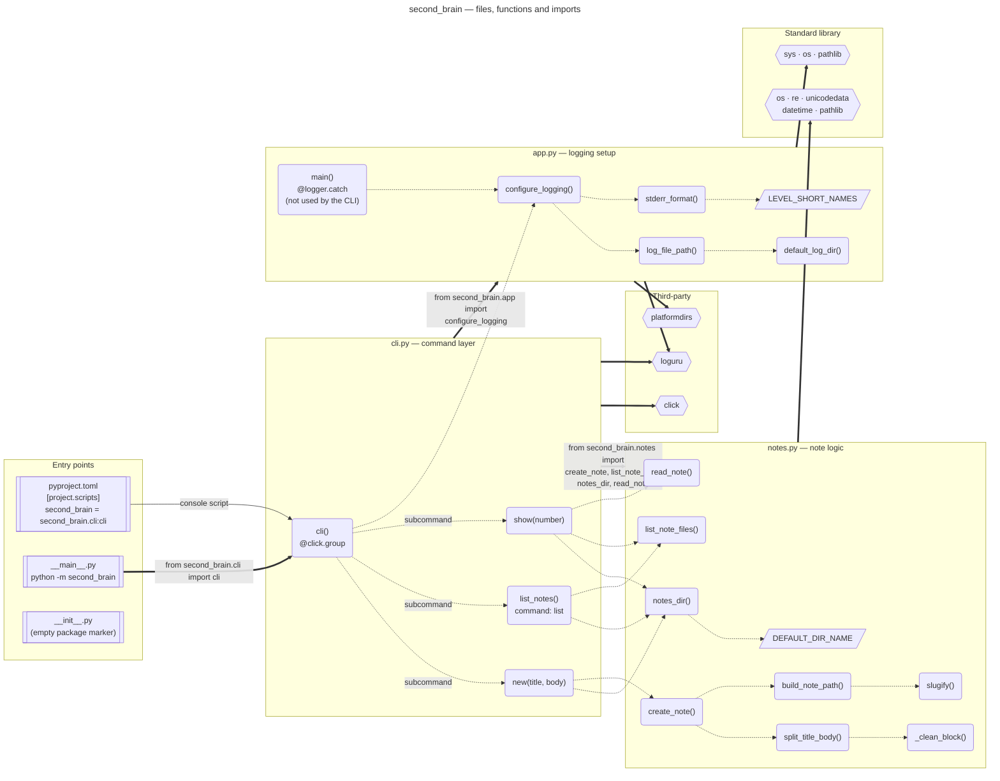
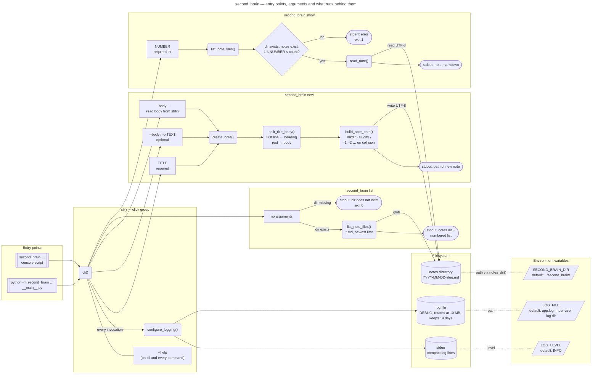

# Diagrams

Three views of the `second_brain` package, from the code structure down to a
typical session at the terminal.

## 1. Files, functions and imports

How the modules in `src/second_brain/` fit together. Thick arrows are imports
between modules and to external libraries; dotted arrows are function calls.

`app.main()` is left over from the project template: nothing in the CLI calls
it. The CLI only uses `configure_logging()` from `app.py`.

## 2. Entry points and arguments

Both ways of launching the tool end up in the same `cli()` click group, which
sets up logging and then hands over to one of the three commands. Each command
shows its arguments, the functions behind it, and where its output goes.

Results go to stdout and log lines to stderr, so command output can be piped
safely. `--help` is available on the group and on every command.

## 3. Example user flow

A common session: set up once, capture a note, then find and reuse it later.

```mermaid
---
title: Example user flow — capture an idea, find it again later
---
flowchart LR
    start(("Idea!"))

    subgraph setup["1 · One-time setup"]
        sync["uv sync"]
        envq{"Custom notes<br/>folder?"}
        setenv["export SECOND_BRAIN_DIR=~/notes<br/>or cp .env.example .env"]
        help["second_brain --help<br/>learn the commands"]
    end

    subgraph capture["2 · Capture"]
        kind{"How long is<br/>the note?"}
        quick["second_brain new &quot;Caching idea&quot;"]
        multi["second_brain new &quot;Caching idea&quot;<br/>--body &quot;Use an LRU.&quot;"]
        piped["cat draft.md |<br/>second_brain new &quot;Draft&quot; --body -"]
        saved(["prints absolute path<br/>…/second_brain/2026-10-25-caching-idea.md"])
    end

    subgraph find["3 · Find it later"]
        list["second_brain list"]
        listed(["Notes: /Users/you/second_brain<br/>1. 2026-10-25-caching-idea.md<br/>2. 2026-10-24-draft.md"])
        show["second_brain show 1"]
        ok{"exit status 0?"}
        read(["note markdown on stdout<br/># Caching idea …"])
        err(["Error on stderr<br/>e.g. Note 9 not found"])
    end

    subgraph reuse["4 · Reuse"]
        pipe["second_brain show 1 | pbcopy<br/>or open the .md in an editor"]
        done(("Done"))
    end

    start --> sync --> envq
    envq -->|yes| setenv --> help
    envq -->|no, use ~/second_brain| help
    help --> kind

    kind -->|one line| quick
    kind -->|a few lines| multi
    kind -->|a whole file| piped
    quick & multi & piped --> saved

    saved -->|days later| list --> listed -->|pick a number| show --> ok
    ok -->|yes| read --> pipe --> done
    ok -->|no| err -->|check the numbers| list
```

